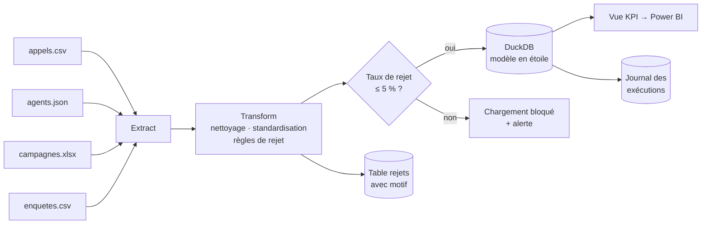
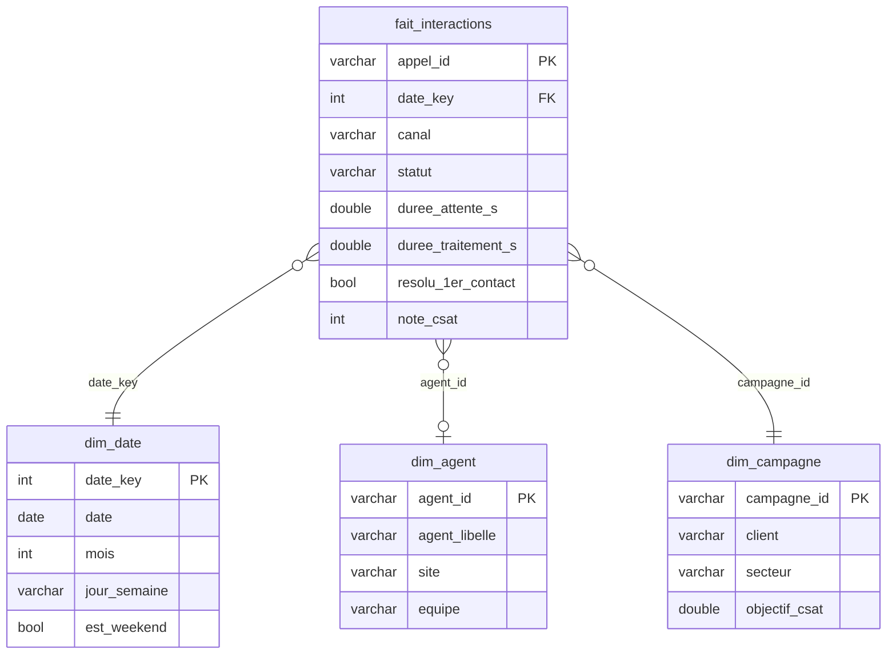

# 📞 Pipeline ETL — Centre de contact multi-clients


Pipeline de données qui **collecte**, **nettoie**, **contrôle** et **charge** les interactions
d'un centre de contact (téléphone, chat, email) dans un **entrepôt en modèle en étoile**,
prêt à être branché sur Power BI.

> ℹ️ Projet personnel. Les données sont **100 % synthétiques**, générées par
> `scripts/generate_data.py`, et volontairement « sales » pour reproduire les problèmes
> rencontrés sur des données réelles.

---

## 🎯 Problématique

Un centre de contact travaille pour plusieurs clients. Les données arrivent de **4 sources
et 3 formats différents**, avec des problèmes classiques :

| Source | Format | Problèmes rencontrés |
|---|---|---|
| Interactions | CSV `;` | 3 formats de date, doublons, libellés incohérents (`TEL`, `téléphone`, `Téléphone`), durées négatives, agents inconnus |
| Agents | JSON | Référentiel RH avec données nominatives |
| Campagnes | Excel | Référentiel clients |
| Enquêtes CSAT | CSV | Notes hors échelle (`0`, `6`, `N/A`) |

## 🏗️ Architecture



### Modèle en étoile



## ✅ Bonnes pratiques mises en œuvre

- **Aucune suppression silencieuse** : chaque ligne écartée va dans la table `rejets` avec son motif.
- **Porte qualité** : si plus de 5 % des lignes sont rejetées, le chargement est bloqué
  (un entrepôt d'hier fiable vaut mieux qu'un entrepôt du jour faux).
- **Chargement transactionnel** : tout ou rien, jamais d'entrepôt à moitié chargé.
- **Idempotence** : relancer le pipeline donne le même résultat.
- **Traçabilité** : chaque exécution est journalisée (`journal_executions`) même en cas d'échec.
- **RGPD dès la conception** : le numéro de téléphone client n'est **pas** chargé
  (inutile à l'analyse) et les noms d'agents sont réduits à « Prénom I. ».
- **Configuration externalisée** (`config/pipeline.yaml`), **tests automatisés** et **CI GitHub Actions**.

## 📊 Résultat d'une exécution

```
Rejets : 566 lignes (2.20 %)
   - doublon appel_id                   200
   - date illisible                     112
   - agent absent du référentiel        100
   - durée de traitement négative        99
   - note CSAT hors échelle 1-5          55
dim_date           :    181 lignes chargées
dim_agent          :     40 lignes chargées
dim_campagne       :      6 lignes chargées
fait_interactions  :  19689 lignes chargées
Exécution terminée en 0.7 s — statut SUCCES
```

La vue `v_kpi_quotidiens` expose directement les indicateurs de pilotage :
taux d'abandon, attente moyenne, durée moyenne de traitement (DMT),
taux de résolution au premier contact (FCR) et satisfaction (CSAT).

## 🚀 Lancer le projet

```bash
git clone https://github.com/GITHUB_USER/callcenter-etl-pipeline.git
cd callcenter-etl-pipeline
python -m venv .venv && source .venv/bin/activate   # Windows : .venv\Scripts\activate
pip install -r requirements.txt

python scripts/generate_data.py   # 1. génère les données sources
python -m etl.pipeline            # 2. exécute le pipeline
pytest                            # 3. lance les 15 tests
```

Exemple de requête sur l'entrepôt :

```python
import duckdb
con = duckdb.connect("data/warehouse/centre_contact.duckdb")
con.sql("SELECT client, SUM(interactions), AVG(csat_moy) FROM v_kpi_quotidiens GROUP BY 1").show()
```

## 📁 Structure

```
├── config/pipeline.yaml        # chemins et seuils
├── etl/
│   ├── extract.py              # lecture CSV / JSON / Excel
│   ├── transform.py            # nettoyage, règles de rejet, modèle en étoile
│   ├── load.py                 # chargement DuckDB
│   └── pipeline.py             # orchestration, porte qualité, journal
├── sql/schema.sql              # DDL de l'entrepôt + vue KPI
├── scripts/generate_data.py    # générateur de données synthétiques
├── docs/dictionnaire_donnees.md
└── tests/                      # tests unitaires + test d'intégration
```

## 🔭 Pistes d'amélioration

- Chargement **incrémental** (ne traiter que les nouvelles interactions) au lieu d'un rechargement complet
- Orchestration avec **Airflow** ou **Prefect** et planification quotidienne
- Migration des transformations en **dbt**
- Connexion d'un rapport **Power BI** à la vue `v_kpi_quotidiens`

## 🧠 Compétences mobilisées

`Python` `pandas` `SQL` `DuckDB` `modélisation dimensionnelle` `qualité des données`
`RGPD` `tests unitaires` `CI/CD` `documentation`
