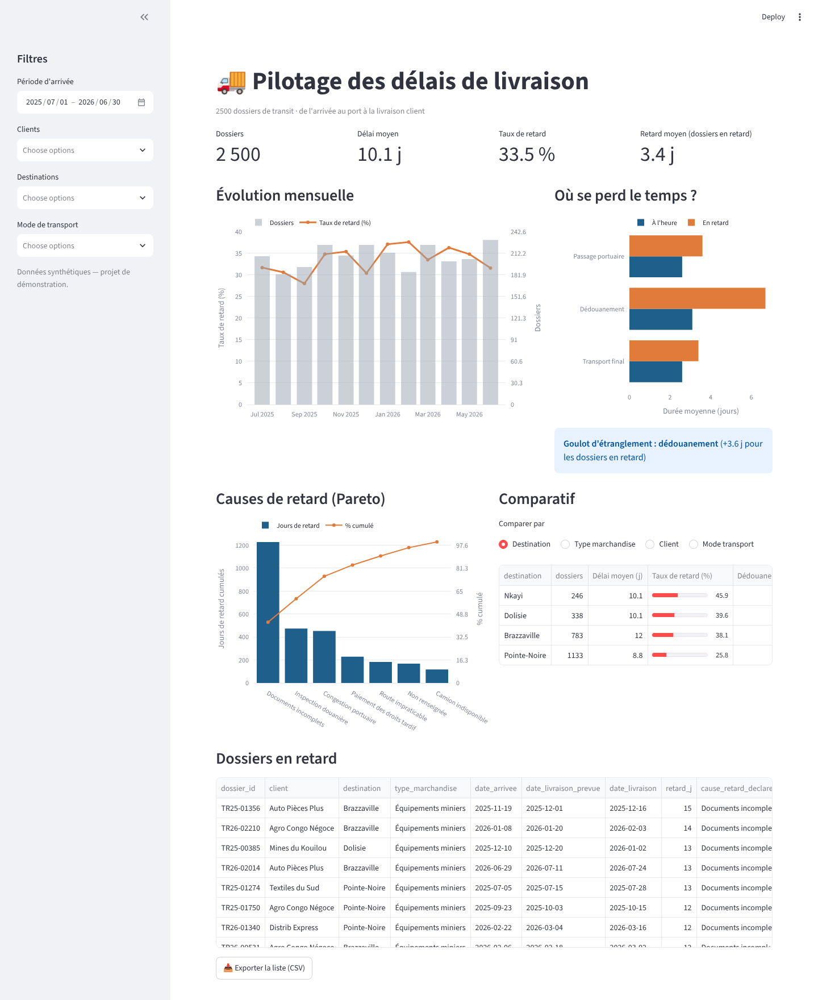

# 🚚 Tableau de bord — Pilotage des délais de livraison


Tableau de bord interactif pour **suivre les délais de livraison de dossiers de transit**
(de l'arrivée au port jusqu'à la livraison client) et **identifier où se perd le temps**.

> ℹ️ Projet personnel **inspiré de mon stage de Data Analyst chez un transitaire à Pointe-Noire**,
> où j'avais construit un tableau de bord Excel de suivi des délais et retards.
> J'ai repris la problématique en Python avec des **données synthétiques** (aucune donnée de l'entreprise).



---

## 🎯 Questions auxquelles répond le tableau de bord

| Question | Visualisation |
|---|---|
| Quel est notre délai moyen et notre taux de retard ? | Indicateurs clés (comparés au global quand on filtre) |
| La situation s'améliore-t-elle ? | Évolution mensuelle du taux de retard et des volumes |
| **À quelle étape** perd-on du temps ? | Durée moyenne de chaque étape : dossiers à l'heure vs en retard |
| Quelles causes pèsent le plus ? | **Diagramme de Pareto** des jours de retard |
| Quels clients / destinations / marchandises sont les plus touchés ? | Tableau comparatif |
| Quels dossiers traiter en priorité ? | Liste des dossiers en retard, **exportable en CSV** |

## 🔎 Ce que montrent les données de démonstration

- **1 dossier sur 3** est livré en retard (33,5 %), avec un retard moyen de 3,4 jours.
- Le **dédouanement est le goulot d'étranglement** : il dure 6,7 j en moyenne pour les dossiers
  en retard contre 3,1 j pour ceux livrés à l'heure (+3,6 j), loin devant les autres étapes.
- Selon le Pareto, **3 causes** (documents incomplets, inspection douanière, congestion portuaire)
  expliquent **~75 % des jours de retard**. Les « documents incomplets » à eux seuls : 43 %.
  👉 Action prioritaire : une **check-list documentaire** avant l'arrivée de la marchandise.
- **15 % des retards n'ont pas de cause renseignée** : c'est aussi un problème de **qualité de données**
  à corriger à la saisie, sinon le pilotage reste partiel.
- Les **équipements miniers** et **matériaux BTP** ont les dédouanements les plus longs.

## 🧱 Architecture

```
├── analyse.py          # toute la logique de calcul (fonctions pures, testées)
├── app.py              # interface Streamlit (filtres, graphiques, export)
├── scripts/generate_data.py
└── tests/test_analyse.py
```

La logique de calcul est **séparée de l'interface** : les mêmes fonctions peuvent alimenter
un rapport automatique, un notebook ou un autre outil (Power BI via un export).

Définitions :
- **Délai total** = date de livraison − date d'arrivée au port
- **Retard** = date de livraison − date promise au client (0 si livré à temps)
- **Étapes** : passage portuaire → dédouanement → transport final

## 🚀 Lancer le projet

```bash
pip install -r requirements.txt
python scripts/generate_data.py
streamlit run app.py          # ouvre http://localhost:8501
pytest                        # 7 tests
```

## 🔭 Pistes d'amélioration

- **Prédire** le risque de retard d'un dossier dès son arrivée (classification : régression logistique, random forest)
- Alertes automatiques quand un dossier dépasse un seuil à une étape
- Connexion à une base de données plutôt qu'à un CSV
- Version **Power BI** du même tableau de bord

## 🧠 Compétences mobilisées

`Python` `pandas` `Streamlit` `Plotly` `data visualisation` `définition de KPI`
`analyse de Pareto` `tests unitaires` `logistique`
