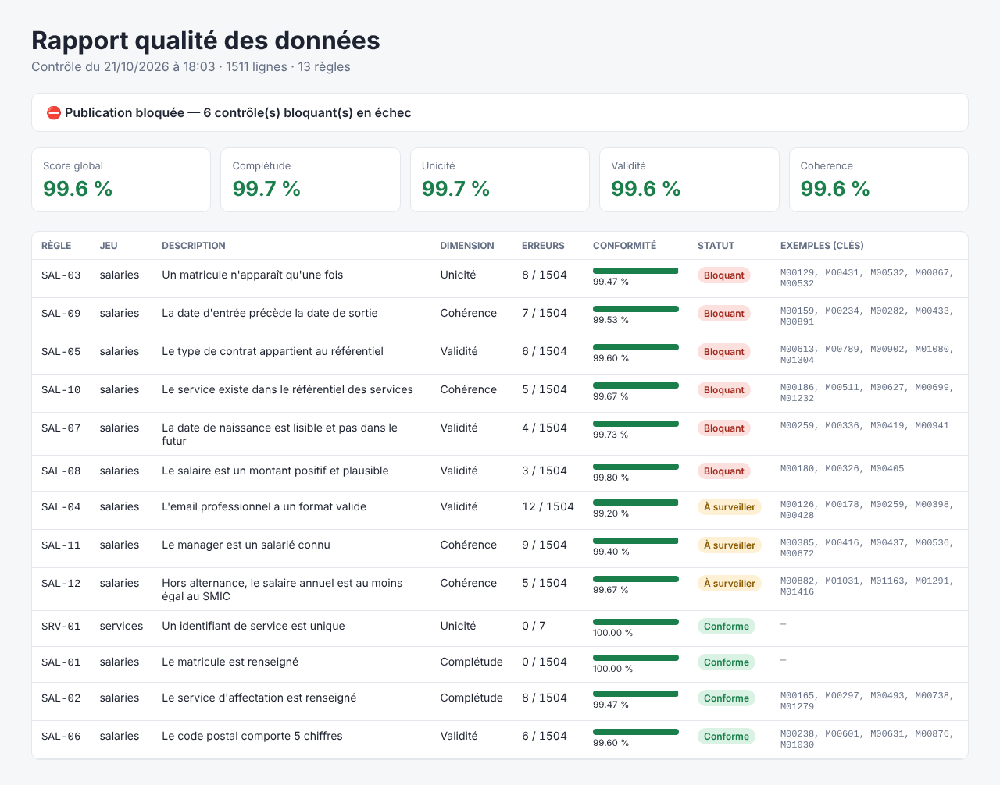

# 🛡️ Data Quality Checker — contrôles qualité pilotés par règles YAML


Mini-framework Python qui **contrôle automatiquement la qualité d'un jeu de données**
à partir de règles écrites en **YAML**, calcule un **score par dimension qualité**,
produit un **rapport HTML lisible par les métiers** et **bloque la publication**
des données si un contrôle critique échoue.

> ℹ️ Projet personnel. Démonstration sur un extrait **fictif** de SIRH (1 500 salariés)
> dans lequel des anomalies ont été injectées en quantité connue — les tests vérifient
> que **chacune** est retrouvée.



---

## 🎯 Pourquoi ce projet

Des tableaux de bord fiables reposent sur des données fiables. Plutôt que de
corriger les erreurs « à la main » dans Excel à chaque fois, l'idée est de :

1. **décrire** ce qu'est une donnée correcte (les règles),
2. **mesurer** automatiquement l'écart à chaque chargement,
3. **empêcher** que des données fausses arrivent dans les outils de pilotage.

Les règles sont dans un fichier YAML et non dans le code : un analyste ou un
responsable métier peut les **lire, les discuter et les faire évoluer**.

## 🧩 Les 4 dimensions qualité contrôlées

| Dimension | Question posée | Règles disponibles |
|---|---|---|
| **Complétude** | La donnée est-elle renseignée ? | `non_null` |
| **Unicité** | Y a-t-il des doublons ? | `unique` (une ou plusieurs colonnes) |
| **Validité** | La donnée respecte-t-elle le format attendu ? | `format` (regex), `valeurs_autorisees`, `intervalle`, `date_valide` |
| **Cohérence** | Est-elle cohérente avec le reste ? | `ordre_dates`, `cle_etrangere`, `expression` (règle métier libre) |

Exemple de règle :

```yaml
- id: SAL-09
  type: ordre_dates
  avant: date_entree
  apres: date_sortie
  dimension: Cohérence
  severite: bloquant          # bloque la publication si en échec
  description: La date d'entrée précède la date de sortie
```

## 📊 Résultat sur le jeu de démonstration

```
Score global : 99.63 %
  [KO ] SAL-03     8 erreur(s)  Un matricule n'apparaît qu'une fois
  [KO ] SAL-05     6 erreur(s)  Le type de contrat appartient au référentiel
  [KO ] SAL-09     7 erreur(s)  La date d'entrée précède la date de sortie
  [!! ] SAL-04    12 erreur(s)  L'email professionnel a un format valide
  ...
BLOQUÉ : 6 contrôle(s) bloquant(s) en échec
```

👉 Un score de 99,6 % semble excellent, **mais** 8 matricules en double ou 7 dates de
sortie antérieures à l'entrée fausseraient un calcul d'effectif ou d'ancienneté :
c'est pourquoi la notion de **sévérité** compte plus que le score global.

Pour chaque règle, le rapport donne des **exemples de clés en erreur** pour que les
équipes puissent corriger à la source.

## 🚀 Lancer le projet

```bash
pip install -r requirements.txt
python scripts/generate_data.py                                   # données de démo
python -m dq.cli --config config/regles_rh.yaml --sortie rapports # contrôle
pytest                                                            # 20 tests
```

Le programme renvoie le **code retour 1** si les données sont bloquées : il peut donc
être placé comme étape d'un pipeline (Airflow, GitHub Actions…) pour stopper un chargement.

Livrables produits :
- `rapports/rapport_qualite.html` — pour les humains
- `rapports/rapport_qualite.json` — pour les outils (historisation, Power BI…)

## 🧱 Architecture du code

```
dq/
├── regles.py    # catalogue de règles (1 fonction = 1 règle, enregistrée par décorateur)
├── moteur.py    # lecture YAML, exécution, calcul des scores et du verdict
├── rapport.py   # rapport HTML + export JSON
└── cli.py       # interface en ligne de commande
config/regles_rh.yaml   # les règles du jeu de démonstration
```

Ajouter un nouveau type de contrôle = écrire une fonction de quelques lignes :

```python
@regle("non_negatif")
def non_negatif(df, colonne, **_):
    return pd.to_numeric(df[colonne], errors="coerce") < 0   # True = ligne en erreur
```

## 🔭 Pistes d'amélioration

- Historiser les scores pour suivre l'**évolution de la qualité** dans le temps
- Contrôles de **fraîcheur** (date de dernière mise à jour) et de **volumétrie** (écart vs J-1)
- Lecture directe depuis une base SQL plutôt que des CSV
- Comparaison avec **Great Expectations** / **Soda** (outils du marché qui reprennent ces principes)

## 🧠 Compétences mobilisées

`Python` `pandas` `qualité des données` `gouvernance` `YAML` `expressions régulières`
`tests unitaires` `CI/CD` `HTML/CSS`
