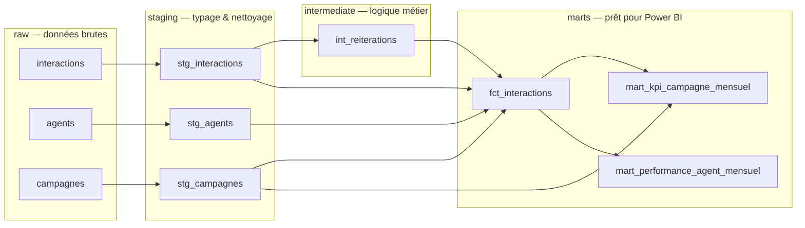

# 📈 KPI Relation Client en SQL — modélisation en couches & analyses


Transformation de ~73 000 interactions clients brutes en **tables de pilotage fiables**,
avec une architecture SQL **en couches** (staging → intermediate → marts),
des **tests de données en SQL**, puis **6 analyses métier** utilisant les fonctions avancées
(fenêtres, `LAG`, `RANK`, `NTILE`, `QUALIFY`, « gaps and islands »).

> ℹ️ Projet personnel — données **synthétiques** générées par `scripts/generate_data.py`.

---

## 🏗️ Architecture (lignage des données)



| Couche | Rôle | Règle |
|---|---|---|
| **staging** | Typage, renommage, colonnes dérivées simples | 1 modèle = 1 source |
| **intermediate** | Logique métier réutilisable | ex. détection des recontacts sous 7 jours |
| **marts** | Tables finales orientées usage | consommées par les tableaux de bord |

Un petit orchestrateur (`run.py`, ~80 lignes) reprend les conventions de **dbt** :
chaque fichier `.sql` contient un `SELECT`, matérialisé en table dans le schéma de sa couche.

## ✅ Tests de données

Chaque fichier de `tests/` est une requête qui renvoie les **lignes en erreur** — un test réussi renvoie 0 ligne.

```
3. Tests de données
  [OK  ] coherence_statuts          un abandon n'a ni agent, ni durée, ni résolution
  [OK  ] integrite_agents           toute interaction traitée a un agent connu
  [OK  ] reconciliation_volumes     volume source = somme des agrégats (rien de perdu)
  [OK  ] taux_entre_0_et_1          les taux sont des proportions valides
  [OK  ] unicite_interaction_id     pas de doublon dans la table de faits
```

## 🔎 Indicateur clé : le FCR « déclaré » vs « réel »

Le taux de résolution au premier contact (FCR) est souvent **déclaré par l'agent**.
Pour le fiabiliser, le modèle `int_reiterations` utilise `LEAD()` pour détecter
les clients qui **recontactent la même campagne sous 7 jours** :

```sql
LEAD(horodatage) OVER (PARTITION BY client_id, campagne_id ORDER BY horodatage) AS prochain_contact
```

Une demande « résolue » suivie d'un recontact n'est pas comptée dans le FCR réel.

| Client | FCR déclaré | FCR réel | Écart | Objectif | Mois objectif atteint |
|---|---|---|---|---|---|
| Banque Horizon | 74,7 % | 68,0 % | 6,7 pts | 68 % | 3 / 6 |
| MobiTrans | 68,1 % | 61,5 % | 6,6 pts | 62 % | 1 / 6 |
| Énergie Plus | 72,3 % | 65,9 % | 6,5 pts | 65 % | 6 / 6 |
| AssurVie | 69,3 % | 63,1 % | 6,2 pts | 65 % | 0 / 6 |
| TelcoNova | 64,2 % | 58,8 % | 5,4 pts | 60 % | 1 / 6 |

👉 Sur la base du FCR déclaré, **toutes** les campagnes sembleraient au-dessus de leur objectif.
Le FCR réel montre qu'AssurVie ne l'a jamais atteint.

## 📊 Les 6 analyses (`analyses/`)

| # | Question métier | Techniques SQL |
|---|---|---|
| 01 | À quelles heures la charge est-elle maximale ? Impact sur le SLA ? | agrégation conditionnelle, pivot |
| 02 | Comment évoluent les volumes chaque semaine ? | `LAG`, moyenne mobile (`ROWS BETWEEN`) |
| 03 | Le FCR déclaré est-il fiable ? | agrégats filtrés (`FILTER`) |
| 04 | Quelles campagnes ratent leur SLA, et combien de mois d'affilée ? | *gaps and islands* (`ROW_NUMBER`) |
| 05 | L'ancienneté influence-t-elle la performance ? | segmentation `CASE` |
| 06 | Top 3 des agents par site le dernier mois | `RANK`, `QUALIFY`, sous-requête |

**Exemples de constats :**
- Pics de charge à **10h et 14h** : le SLA chute alors de ~78 % à **~68 %** → piste : décaler des pauses.
- **TelcoNova**, **AssurVie** et **Énergie Plus** ratent leur SLA **6 mois sur 6** (Énergie Plus de peu : 78,8 % pour 80 %) : problème structurel de dimensionnement, pas un accident ponctuel.
- Les agents de **plus de 3 ans** résolvent ~**7 points** de plus que ceux de moins de 2 ans → plan de tutorat avec les agents « top 3 ».

Les résultats complets sont exportés en CSV dans `resultats/`.

## 🚀 Lancer le projet

```bash
pip install -r requirements.txt
python scripts/generate_data.py   # données synthétiques
python run.py build               # chargement + modèles + tests  (code retour 1 si un test échoue)
python run.py analyses            # exécute les 6 analyses -> resultats/*.csv
```

## 📁 Structure

```
├── models/
│   ├── staging/         stg_interactions.sql, stg_agents.sql, stg_campagnes.sql
│   ├── intermediate/    int_reiterations.sql
│   └── marts/           fct_interactions.sql, mart_kpi_campagne_mensuel.sql, mart_performance_agent_mensuel.sql
├── tests/               5 tests de données en SQL
├── analyses/            6 requêtes d'analyse commentées
├── run.py               mini-orchestrateur
└── scripts/generate_data.py
```

## 🔭 Pistes d'amélioration

- Migrer vers **dbt-duckdb** (les conventions sont déjà compatibles)
- Matérialisation **incrémentale** de `fct_interactions`
- Rapport **Power BI** connecté aux tables `marts`

## 🧠 Compétences mobilisées

`SQL avancé` `fonctions de fenêtre` `CTE` `modélisation en couches` `tests de données`
`DuckDB` `définition d'indicateurs` `analyse métier`
